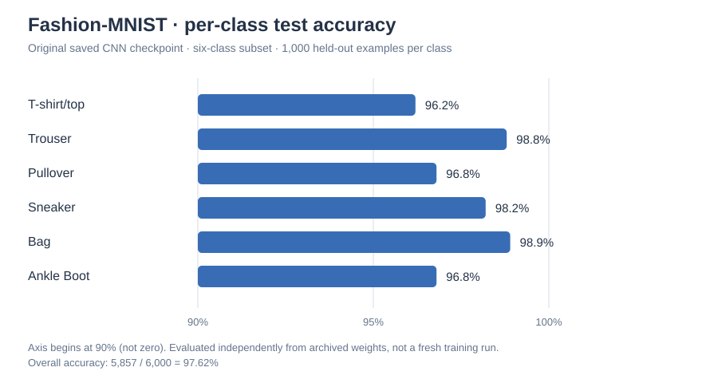

# Fashion-MNIST image classification (PyTorch)

An **individual deep-learning coursework project** by Seyed Ali Poorseyed. I implemented convolutional neural network (CNN) and multilayer perceptron (MLP) classifiers using PyTorch and explored image rotation and augmentation with a PyTorch Lightning training pipeline.

> **Status:** This is a cleaned, refactored portfolio version of my original coursework code. Model smoke tests and a short real-data training/checkpoint-loading cycle passed locally; archived CNN weights were independently evaluated on the held-out six-class test subset. A new **full multi-epoch training run** of the refactored code has not been completed.

## Dataset and task

This project uses **six categories**, not all ten Fashion-MNIST classes: T-shirt/top, Trouser, Pullover, Sneaker, Bag, and Ankle Boot. Their labels are remapped to 0–5. The dataset is downloaded automatically through torchvision; the dataset files are not included in the repository.

## Methods

- CNN and MLP models for 28×28 grayscale images
- Data filtering, label remapping and normalization
- Optional image rotations and augmentations
- Training, validation and testing with PyTorch Lightning
- TensorBoard logs, model checkpoints and per-class evaluation

Rotation and vertical flip experiments are robustness investigations; such transformations do not necessarily preserve the semantic identity of clothing images.

## Files

| File | Purpose |
| --- | --- |
| fmnist.py | Load and filter six Fashion-MNIST classes, apply transformations |
| networks.py | Original CNN and MLP architectures |
| networks_lightning.py | Lightning training/validation/testing logic |
| project_main.py | Command-line experiments and evaluation |
| tests/test_models.py | Offline model smoke tests |
| requirements.txt | Python dependencies |

## Run locally

Python 3.10+ is recommended. Create a virtual environment and install dependencies:

~~~bash
python -m venv .venv
# Windows PowerShell: .venv\Scripts\Activate.ps1
# macOS/Linux: source .venv/bin/activate
python -m pip install -r requirements.txt
~~~

For GPU use, select an appropriate PyTorch build from the [official installation guide](https://pytorch.org/get-started/locally/).

~~~bash
# Train a CNN and evaluate its best validation checkpoint
python project_main.py --train --evaluate --model-type CNN --epochs 20

# Compare against the MLP
python project_main.py --train --evaluate --model-type MLP --epochs 20

# Explore train and test rotations
python project_main.py --train --evaluate --rotate-train --rotate-test

# Examine balanced and per-class accuracy after training
python project_main.py --train --analyze-errors

# Evaluate a previously saved checkpoint
python project_main.py --evaluate --checkpoint path/to/model.ckpt

# Run quick tests (no Fashion-MNIST download needed)
python -m pip install pytest
python -m pytest -q
~~~

The experiment runner uses a seeded 80/20 train/validation split. An important change from the original version is that **validation uses an unaugmented dataset instance**, avoiding random training transformations on validation samples.

## Verified results from archived CNN weights

The original project archive contained a CNN checkpoint at `model_checkpoints/best-epoch=4-val_acc=0.98.ckpt`. I loaded its model weights into the architecture in `networks.py` and evaluated them on the six-class **held-out Fashion-MNIST test set**. This produced **5,857 correct predictions out of 6,000 (97.62% accuracy)**, with 1,000 test images per class.

| Class | Correct / total | Accuracy |
| --- | ---: | ---: |
| T-shirt/top | 962 / 1,000 | 96.2% |
| Trouser | 988 / 1,000 | 98.8% |
| Pullover | 968 / 1,000 | 96.8% |
| Sneaker | 982 / 1,000 | 98.2% |
| Bag | 989 / 1,000 | 98.9% |
| Ankle Boot | 968 / 1,000 | 96.8% |

The [CSV results](results/per_class_accuracy.csv) contain the corresponding counts. Another independently evaluated historical checkpoint yielded **97.53%**. The repository also includes `evaluate_saved_checkpoint.py` for verifying an original checkpoint locally, **if you have its file**:

~~~bash
python evaluate_saved_checkpoint.py --checkpoint path/to/original.ckpt
~~~

These are test results from **previously trained weights**, not accuracy obtained by freshly training the refactored code. The model binary isn't committed because the repository is intended to remain small.

## Results and limitations

The original submitted notebook includes historical saved training output, but it is not included here because it contains course instructions and identifying information. An archived CNN checkpoint **was** independently evaluated on the original held-out test images, as documented above, but the training procedure has not been fully repeated. This repository should **not** be interpreted as a benchmark for the standard ten-class Fashion-MNIST task.

Three model smoke tests passed. A short real-data training / checkpoint save / reload / evaluation cycle also passed, and archived CNN weights were independently tested on all 6,000 held-out images. Full multi-epoch runs need compatible dependencies, network access for first-time dataset download and additional compute resources. A fixed environment lockfile has not yet been established.

Downloaded datasets, model checkpoint binaries and TensorBoard logs are intentionally omitted.

## Authorship and attribution

**Individual project implementation:** Seyed Ali Poorseyed. The dataset is Fashion-MNIST from [Zalando Research](https://github.com/zalandoresearch/fashion-mnist). This is a refactored presentation of the original academic work rather than a claim that the original submission was identical to the code here. The code is released under the MIT License (see `LICENSE`).
